<p align="center">
  <a href="https://furkiozknn.github.io/dolmus/"></a>
</p>

<p align="center">
  <a href="https://furkiozknn.github.io/dolmus/"></a>
  
  
  <a href="LICENSE"></a>
  
</p>

<p align="center"><b>A 3D arcade driving game about the shared minibus taxis of Turkish cities: drive a yellow dolmuş through a low-poly Istanbul-style neighbourhood, pick up waving passengers, drop them at their stops and earn fares and tips.</b></p>

<p align="center">
  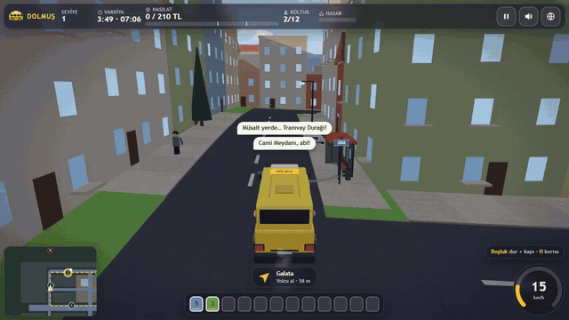
  <br>
  <sub>Watch the promo: <a href="https://github.com/Furkiozknn/social-videos/releases/download/promo-2026-10/2026-10-28-dolmus-en.mp4">EN</a> · <a href="https://github.com/Furkiozknn/social-videos/releases/download/promo-2026-10/2026-10-28-dolmus-tr.mp4">TR</a></sub>
</p>

<p align="center"><b>Play online: <a href="https://furkiozknn.github.io/dolmus/">https://furkiozknn.github.io/dolmus/</a></b> (desktop and phone, no install)</p>

## Highlights

- **A shared taxi, not a race.** Stop at the stops, open the door, let passengers off (they pay) and new ones on; each
  one tells you where they are going in a chat bubble, and the 12 seat chips show who gets off where.
- **Tips for good driving.** Fast and smooth rides earn tips; red lights, crashes, hard braking with passengers on board
  and skipped passengers cost you, and at 100 % dents the shift is over.
- **Eight shifts and an endless mode.** New routes, a tram and buses, rain, a double-parked van, narrow streets with a
  VIP passenger, a traffic jam, the ferry pier, the evening rush and a night shift.
- **A living street.** Traffic follows lanes and lights, pedestrians cross at zebras, the tram obeys its signals, and
  pigeons scatter at the horn.
- **Balanced by a bot.** The `?auto` bot drives with the same controls and rules as a player and finished all 8 levels;
  the star thresholds were calibrated against it.
- **Light on a laptop GPU.** About 60 fps (the vsync cap) on an Intel UHD 630 laptop at 1280x720 with 42 draw calls on
  the High tier, and a `?low` tier for phones ([measurements](docs/assets.md)).
- **One file, made in code.** One `index.html` with Three.js r170 from a CDN; the base game is procedural, with an
  optional CC0 asset pass loaded on top.

## How to play

> [!TIP]
> **Goal:** a shift lasts 4 minutes. Drive the fixed route (6 to 10 stops, numbered on the minimap) and earn as many
> Turkish lira as you can; 1 to 3 stars depend on your net total versus the level target.

Waiting passengers wave when you get close. Press **Space** within about 13 m of a stop (or of a waving passenger): the
dolmuş brakes to a halt and opens the door. Passengers get off first and pay, then new ones board and tell you their
stop (chat bubble, numbered seat chip, green ring and light beam at the destination).

<details>
<summary><b>More rules</b></summary>

- **Tips** reward fast rides (the shrinking patience bar on the seat chip shows the expected time) and smooth rides (no
  hard braking, no crashes while they are on board). VIP passengers pay triple but have little patience.
- **Penalties:** running a red light, hitting cars (also raises the dent meter), hard braking with passengers on board,
  skipping a waving passenger when you have a free seat, hitting a pedestrian, and passengers who give up waiting. At
  100 % dents the dolmuş is wrecked and the shift ends.
- A full dolmuş accelerates noticeably slower. Rain makes the road slippery and fills the stops with people. Pigeons,
  pedestrians, a tram, buses and a double-parked van are all part of the traffic puzzle.

| # | Level | New in this level |
|---|---|---|
| 1 | Main street run | lights, zebra crossings, 6 stops |
| 2 | Bridge and tram | new route over the canal bridges, tram, buses |
| 3 | Here comes the rain | rain showers, double-parked delivery van |
| 4 | Narrow streets | side streets with cars parked on the pavement, the mosque square, VIP passenger |
| 5 | Gridlock | traffic jam event on the main street, rain |
| 6 | The ferry pier | sea road and ferry pier stop, 9 stops |
| 7 | Evening rush | dusk, everything at once, 10 stops |
| 8 | Night shift | night, wet roads, three VIPs |
| E | Endless | repeating shifts that get harder, ends when you miss the target or wreck the car |

</details>

### Controls

| Action | Mouse / touch | Keyboard |
|---|---|---|
| Accelerate | gas pedal | `W` / `Up` |
| Brake, reverse | brake pedal | `S` / `Down` |
| Steer | steering slider | `A` `D` / `Left` `Right` |
| Stop and open the door | door button | `Space` |
| Horn | horn button | `H` |
| Pause | pause button | `P` / `Esc` |
| Music / effects / language | HUD buttons | `M` / `X` / `L` |
| Minimap: heading up / north up | tap the minimap | `N` |

A gamepad works too: RT / A accelerate, LT / B brake, the left stick steers, X opens the door, Y is the horn, Start
pauses.

Settings are saved in `localStorage` under `arena.dolmus.settings`; best scores, stars and the run you can continue
under `arena.dolmus.save`. Turkish is the default language.

<details>
<summary><b>URL flags for testing</b></summary>

| Flag | Effect |
|---|---|
| `?auto` | a real driving bot plays the whole campaign (same controls and rules as a player) |
| `?debug` | fps, draw calls, triangles, state, bot results and JS errors on screen; `window.dolmusSim(seconds)` fast-forwards |
| `?sim=N` | fast-forward N seconds of the first shift before the first frame (add `&auto` to let the bot drive) |
| `?low` | shadows off, pixel ratio 1, half the particles, procedural models, no textures or sky |
| `?noassets` | skip every optional asset (models, textures, sky, sounds) and run the procedural game |
| `?assets=models,tex,sky,snd` | load only the listed asset groups |
| `?nocamfix` | turn the chase-camera obstacle avoidance off |
| `?lang=en` / `?lang=tr` | language |
| `?level=N` | start the campaign at level N |
| `?mode=endless` | with `?auto` or `?sim`, start in endless mode |
| `?seed=N` | gameplay random seed (default 7) |
| `?touch` | force the touch controls |
| `?cam=tram`, `van`, `bus`, `mosque`, `pier`, `bridge`, `plaza`, `main` or `x,z` | spectator camera (`camd`, `camh`, `cama` adjust distance, height, angle) |
| `?cal` | with `?auto`: advance to the next level whatever the result (used to calibrate the targets) |

The live state is on `window.dolmus` (state, level, time, net, score, seats, dent, finished shifts, errors). Example:
`index.html?auto&debug&sim=3000` plays the whole campaign in a few seconds without rendering.

</details>

## Screenshots

<table>
  <tr>
    <td width="33%">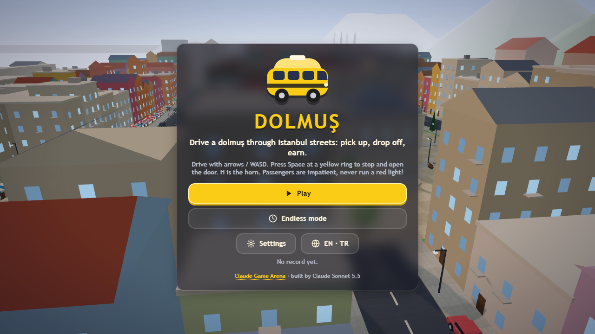<br><sub>Title screen</sub></td>
    <td width="33%">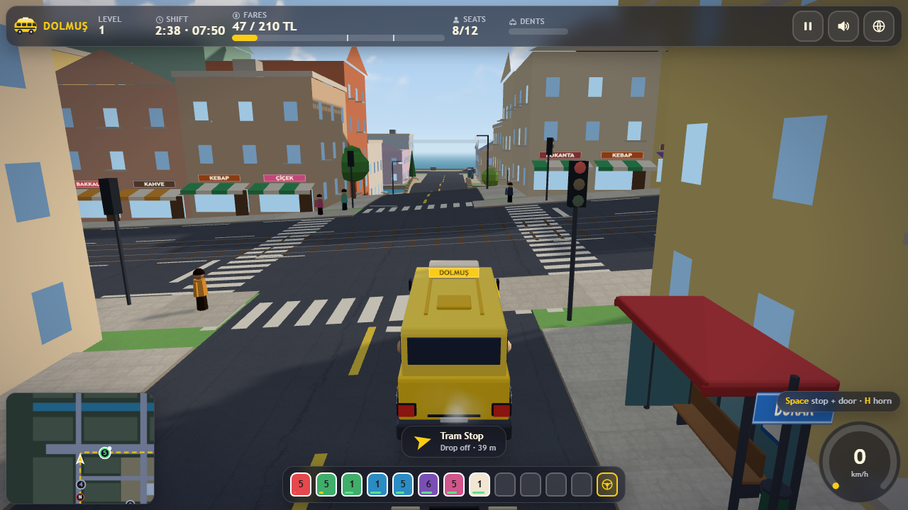<br><sub>Passengers, chat bubbles and tips</sub></td>
    <td width="33%">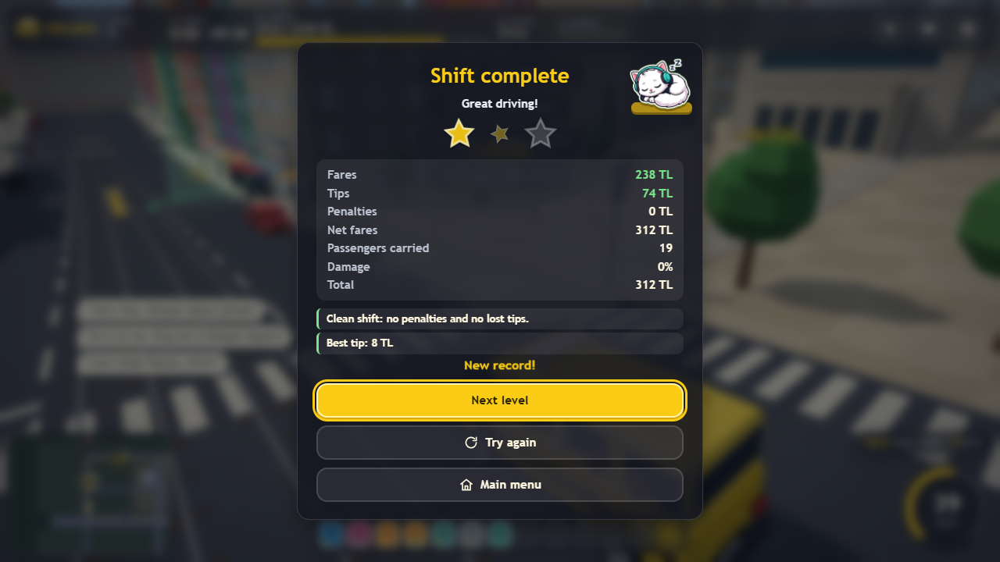<br><sub>Shift summary</sub></td>
  </tr>
  <tr>
    <td>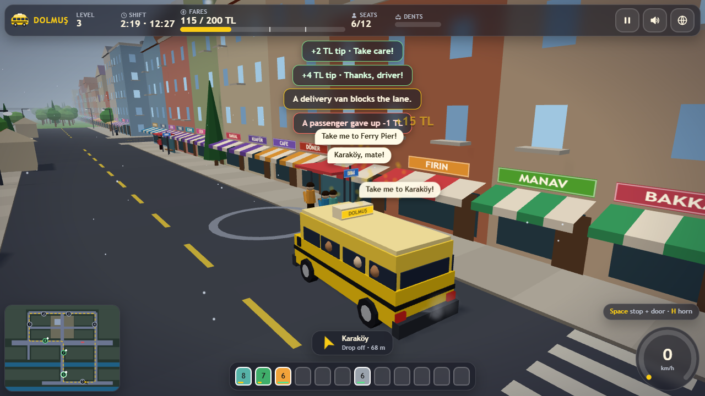<br><sub>Rain and the double-parked van</sub></td>
    <td>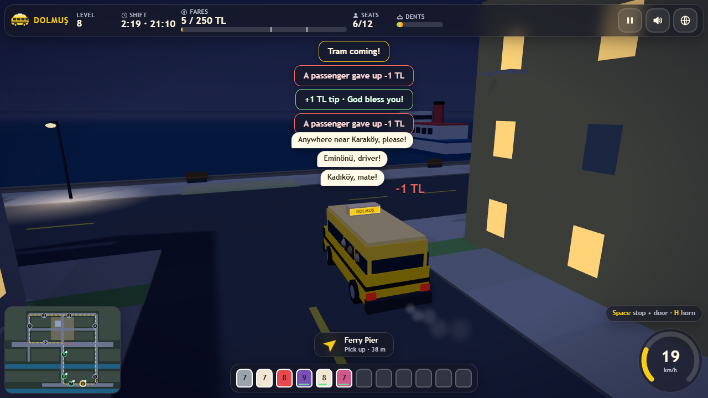<br><sub>Night shift</sub></td>
    <td>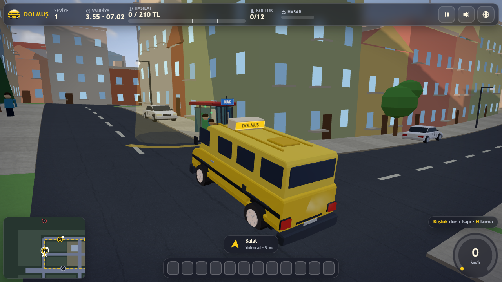<br><sub>At a stop (asset pass)</sub></td>
  </tr>
  <tr>
    <td>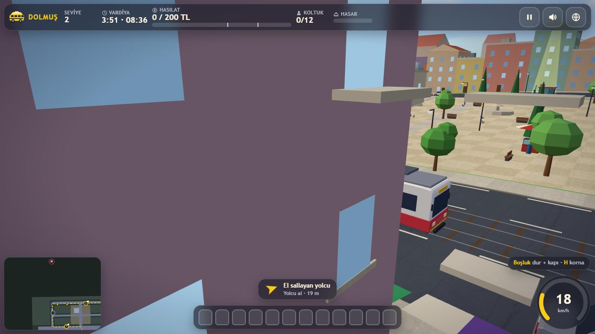<br><sub>The tram</sub></td>
    <td>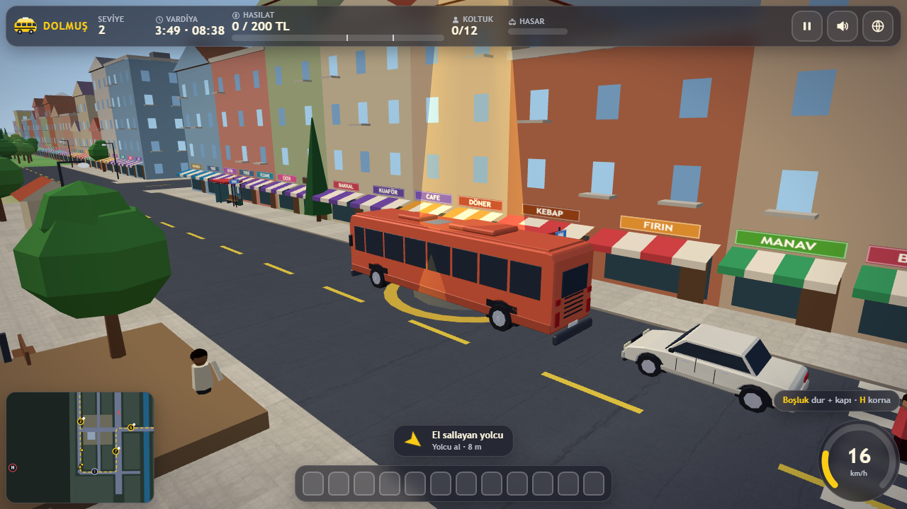<br><sub>A city bus</sub></td>
    <td>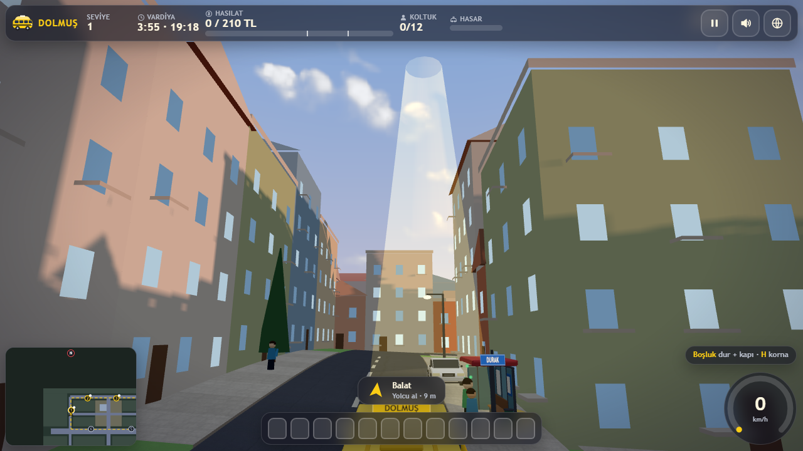<br><sub>Sunset sky</sub></td>
  </tr>
</table>

<details>
<summary><b>Phone layout and the asset pass, before and after</b></summary>

<table>
  <tr>
    <td width="50%">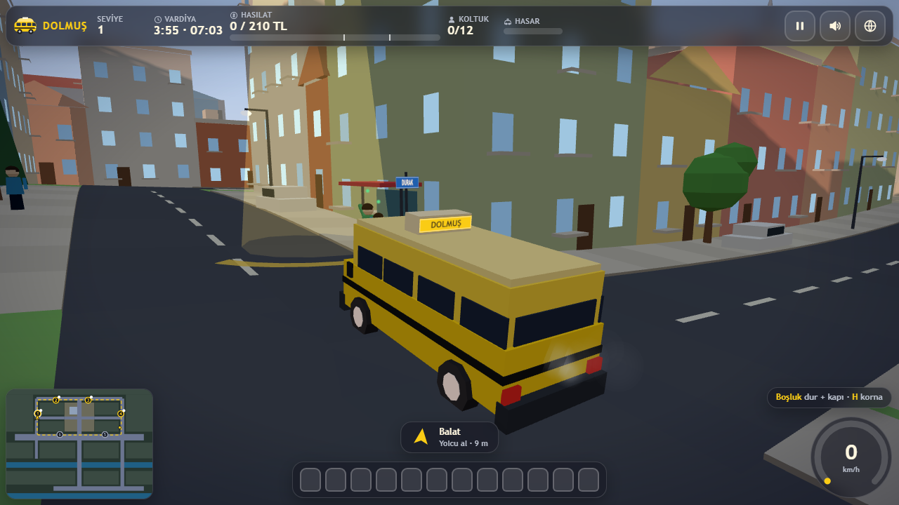<br><sub>Dolmuş, procedural</sub></td>
    <td width="50%"><br><sub>Dolmuş, with the asset pass</sub></td>
  </tr>
  <tr>
    <td>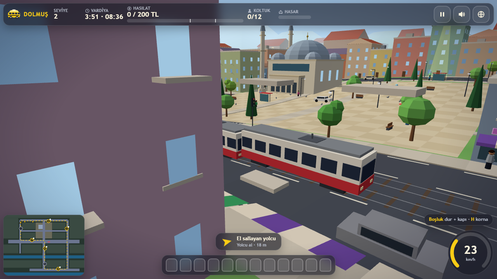<br><sub>Tram, procedural</sub></td>
    <td><br><sub>Tram, with the asset pass</sub></td>
  </tr>
  <tr>
    <td>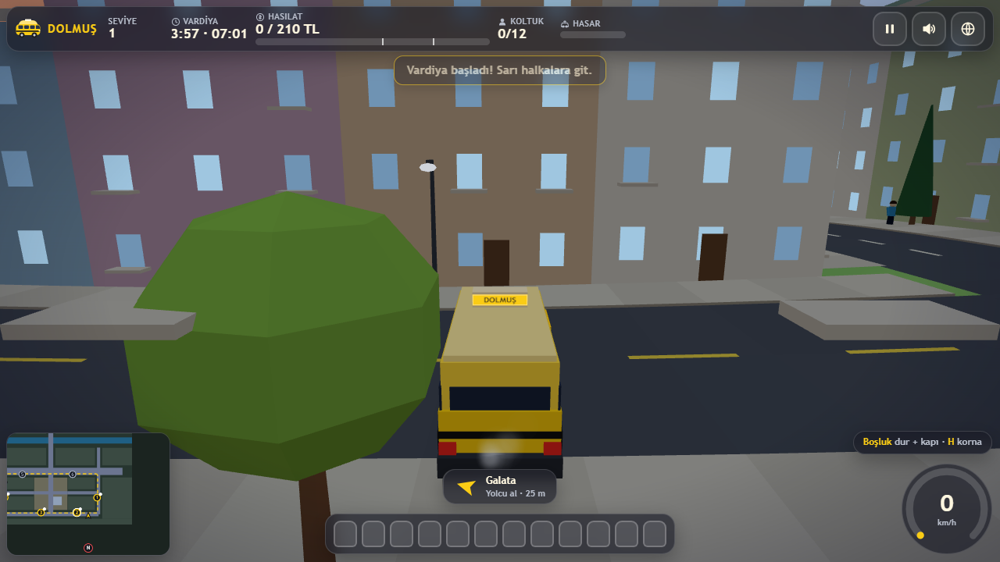<br><sub>Chase camera without the obstacle fix</sub></td>
    <td>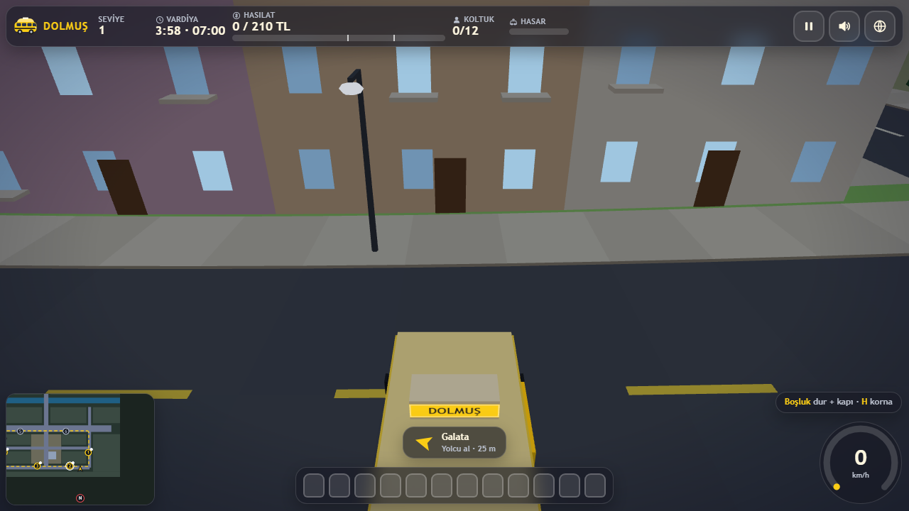<br><sub>Chase camera with the fix</sub></td>
  </tr>
</table>

<p align="center">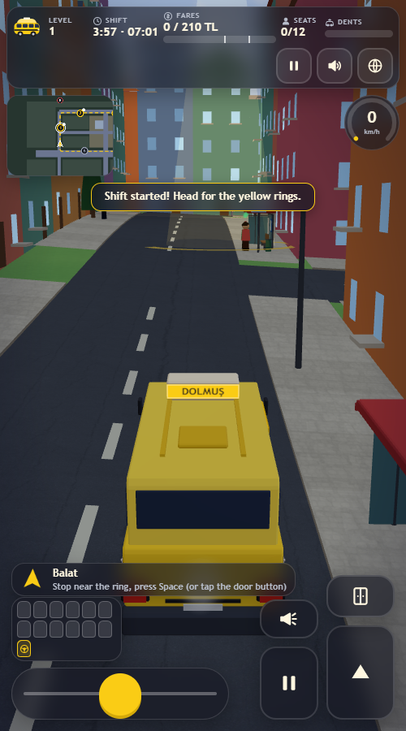<br><sub>On a phone</sub></p>

</details>

## Balance

The simulation runs at a fixed 60 Hz step and does not need the renderer, so `?auto&sim=4000` plays the whole campaign
without rendering. With assets, with `?noassets` and with `?low` it gives the same result: levels 1 to 8 finished, with
stars / net lira 1: 2/306, 2: 1/254, 3: 2/282, 4: 3/402, 5: 2/272, 6: 2/344, 7: 3/459 and 8: 3/478 (after one retry),
and no JS errors ([verification run](docs/assets.md#verification-run)).

## Running locally

Serve the folder over HTTP (opening `index.html` directly also works in most browsers, but then the optional assets do
not load and the game stays procedural):

```
python -m http.server 8000
```

then open <http://localhost:8000/>.

## How it was made

Built by **Claude Sonnet 5.5** with Claude Code from one prompt: [prompts/dolmus.md](prompts/dolmus.md). The base game is
fully procedural: about 300 buildings, roads, trees, the mosque, bridges and the pier are merged low-poly geometry with
vertex colours; cars, buses, the tram, pedestrians and pigeons are instanced. The engine, horn, rain, tram bell, street
ambience and the arabesk-pop style tune in Hicaz are synthesised with the Web Audio API.

An optional asset pass (about 1.13 MB) adds Blender-built low-poly vehicles and props (the dolmuş with its sliding door,
cars, buses, the tram, the van, stop shelters, simit and chestnut carts), Poly Haven detail textures and sky, and Kenney
sounds for the door, coins, crashes and clicks. They load after the first frame, only on the High tier (sounds on both),
and the procedural versions stay as the fallback (`?noassets` skips them). Licences: [CREDITS.md](CREDITS.md); file
list, sizes and fps before and after: [docs/assets.md](docs/assets.md). Model scripts: `assets/src/`.

Dolmuş is part of the **Claude Game Arena** series, where each game is built by a Claude model from one prompt. The
other games: [Hisar](https://furkiozknn.github.io/kale-savunmasi/) ·
[Çay Ocağı](https://furkiozknn.github.io/cay-ocagi/) · [Çini Ustası](https://furkiozknn.github.io/cini-ustasi/) ·
[Martı](https://furkiozknn.github.io/marti/) · [Kervan](https://furkiozknn.github.io/kervan/) ·
[Peri Golf](https://furkiozknn.github.io/peri-golf/) · [Mehter](https://furkiozknn.github.io/mehter/) ·
[Boğaz Vapuru](https://furkiozknn.github.io/bogaz-vapuru/) · [Simit Fırını](https://furkiozknn.github.io/simit-firini/)
· [Karagöz](https://furkiozknn.github.io/karagoz/) · [Lale Bahçesi](https://furkiozknn.github.io/lale-bahcesi/)

**Round 5:** [Kapadokya Balonu](https://furkiozknn.github.io/kapadokya-balonu/) ·
[Ebru](https://furkiozknn.github.io/ebru/) · [Kırkpınar](https://furkiozknn.github.io/kirkpinar/) ·
[Çarşı Kaçışı](https://furkiozknn.github.io/carsi-kacisi/)

## Türkçe

**Dolmuş**, alçak poligon İstanbul tarzı bir mahallede geçen 3D arcade sürüş oyunu. Sarı dolmuşla el sallayan yolcuları
al, balondaki durağı öğren, yolcuyu indir, ücret ve bahşiş topla; kırmızı ışıktan ve kazadan uzak dur. Sekiz vardiya ve
sonsuz mod var: tramvay, yağmur, VIP yolcu, trafik sıkışıklığı ve gece vardiyası. Kurulum yok; masaüstünde ve telefonda
tarayıcıda oynanır. Claude Sonnet 5.5 tarafından Claude Code ile tek bir prompt'tan yapıldı.

**Oyna:** https://furkiozknn.github.io/dolmus/

## License

MIT, see [LICENSE](LICENSE). Third-party assets are CC0, see [CREDITS.md](CREDITS.md).
