<p align="center">
  <a href="https://furkiozknn.github.io/dolmus/">
    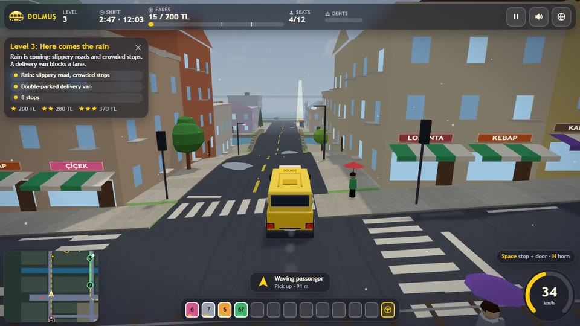
  </a>
</p>

<p align="center">
  <a href="https://furkiozknn.github.io/dolmus/"></a>
</p>

<p align="center">
  
  
  <a href="LICENSE"></a>
  
</p>

<!-- portals:start -->
<p align="center">
  Also on: <a href="https://furkiozknn.itch.io/dolmus"><strong>itch.io</strong></a> &middot; <a href="https://playgama.ai/play/i4q3xdqljprlly"><strong>Playgama</strong></a>
</p>
<!-- portals:end -->

<p align="center">
  <strong>A 3D arcade driving game about the shared minibus taxis of Turkish cities: drive a yellow dolmuş through a low-poly Istanbul-style neighbourhood, pick up waving passengers, drop them at their stops and earn fares and tips.</strong>
</p>

<!-- gameplay gif -->

## Features

- **Eight shifts and endless mode:** Drive 8 distinct shifts lasting 4 minutes each with 6 to 10 stops—from morning canal bridges and rain to the ferry pier and night rush—plus an endless mode calibrated across 1 to 3 stars.
- **Shared minibus mechanics:** Stop within 13 m to board waving passengers across 12 seats, monitor chat bubbles and destination chips, and execute a 3-2-1 countdown start with pulsing-ring guidance.
- **"Müsait bir yerde" & fare chain:** From level 2, about a third of riders request drops at any safe curb within 70 m; fares hop forward row by row along occupied seats where early pullaways forfeit tips.
- **Living city simulation:** Traffic follows lanes and lights across about 300 procedural buildings, zebras, trams, buses, and scattering pigeons, accompanied by 24 unique passenger dialogue lines per language.
- **Ultra-lean web performance:** A single `index.html` running Three.js r170 delivering 60 fps at 52–65 draw calls on Intel UHD 620 (1280x720), verified by an automated bot finishing all 8 shifts with 0 JS errors.

## How to play

> [!TIP]
> **Goal:** A shift lasts 4 minutes. Drive the fixed route (6 to 10 stops, numbered on the minimap) and earn as many Turkish lira as you can; 1 to 3 stars depend on your net total versus the level target.

1. **Drive and spot passengers:** Steer with `A`/`D` (or arrows) and accelerate with `W`. Look for passengers waving on the pavement or waiting at marked stops.
2. **Stop and board (`Space`):** Press `Space` within about 13 m of a stop or waving rider. The dolmuş brakes to a halt and opens the door: alighting passengers pay, new ones board, and fares hop forward to the driver.
3. **Drop off & earn tips:** Deliver riders to their requested stops or safe curbs ("müsait bir yerde") within 70 m. Drive smoothly and avoid collisions, red lights, or hard braking to maximize tips and keep dents under 100%.

<details>
<summary><b>Moves and rules</b></summary>

- **Tips:** Fast and smooth rides earn tips (the shrinking patience bar on the seat chip shows expected time; no hard braking or crashes while on board). VIP passengers pay triple but have little patience.
- **Penalties:** Running a red light, hitting cars (raises the dent meter), hard braking with passengers on board, skipping a waving passenger when you have a free seat, hitting a pedestrian, and passengers who give up waiting. At 100% dents the dolmuş is wrecked and the shift ends.
- **Weight and hazards:** A full dolmuş accelerates noticeably slower. Rain makes the road slippery and fills stops with people. Pigeons, pedestrians, a tram, buses, and a double-parked delivery van are all part of the traffic puzzle.

| # | Level | New in this level |
|---|---|---|
| 1 | Main street run | lights, zebra crossings, 6 stops |
| 2 | Bridge and tram | new route over the canal bridges, tram, buses |
| 3 | Here comes the rain | rain showers, double-parked delivery van |
| 4 | Narrow streets | side streets with cars parked on the pavement, the mosque square, VIP passenger |
| 5 | Gridlock | traffic jam event on the main street, rain |
| 6 | The ferry pier | sea road and ferry pier stop, 9 stops |
| 7 | Evening rush | dusk, everything at once, 10 stops |
| 8 | Night shift | night, wet roads, three VIPs |
| E | Endless | repeating shifts that get harder, ends when you miss the target or wreck the car |

</details>

### Controls

| Action | Mouse / touch | Keyboard |
|---|---|---|
| Accelerate | gas pedal | `W` / `Up` |
| Brake, reverse | brake pedal | `S` / `Down` |
| Steer | steering slider | `A` `D` / `Left` `Right` |
| Stop and open the door | door button | `Space` |
| Horn | horn button | `H` |
| Pause | pause button | `P` / `Esc` |
| Music / effects / language | HUD buttons | `M` / `X` / `L` |
| Minimap: heading up / north up | tap the minimap | `N` |

- **Gamepad:** RT / `A` accelerate, LT / `B` brake, left stick steers, `X` opens the door, `Y` horn, `Start` pause.
- **Audio control:** `M` mutes/unmutes music, `X` sound effects, `L` toggles language.
- **Touch:** Gas and brake pedals, steering slider, door button, horn button, and tap the minimap to toggle orientation.
- **Persistence:** Settings (master/music/effects volume, mute, language, quality tier) are saved in `localStorage` under `arena.dolmus.settings`; best scores, stars, and run progress under `arena.dolmus.save`. The language follows the browser (Turkish when browser language starts with `tr`, English otherwise); the toggle and `?lang=` override it.

<details>
<summary><b>URL flags for testing</b></summary>

| Flag | Effect |
|---|---|
| `?auto` | a real driving bot plays the whole campaign (same controls and rules as a player) |
| `?debug` | fps, draw calls, triangles, state, bot results and JS errors on screen; `window.dolmusSim(seconds)` fast-forwards |
| `?sim=N` | fast-forward N seconds of the first shift before the first frame (add `&auto` to let the bot drive) |
| `?low` | shadows off, pixel ratio 1, half the particles, procedural models, no textures or sky |
| `?noassets` | skip every optional asset (models, textures, sky, sounds) and run the procedural game |
| `?assets=models,tex,sky,snd` | load only the listed asset groups |
| `?nocamfix` | turn the chase-camera obstacle avoidance off |
| `?lang=en` / `?lang=tr` | language |
| `?level=N` | start the campaign at level N |
| `?mode=endless` | with `?auto` or `?sim`, start in endless mode |
| `?seed=N` | gameplay random seed (default 7) |
| `?touch` | force the touch controls |
| `?cam=tram`, `van`, `bus`, `mosque`, `pier`, `bridge`, `plaza`, `main` or `x,z` | spectator camera (`camd`, `camh`, `cama` adjust distance, height, angle) |
| `?cal` | with `?auto`: advance to the next level whatever the result (used to calibrate the targets) |

The live state is on `window.dolmus` (state, level, time, net, score, seats, dent, finished shifts, errors). Example: `index.html?auto&debug&sim=3000` plays the whole campaign in a few seconds without rendering.

</details>

## Screenshots

<table>
  <tr>
    <td width="33%">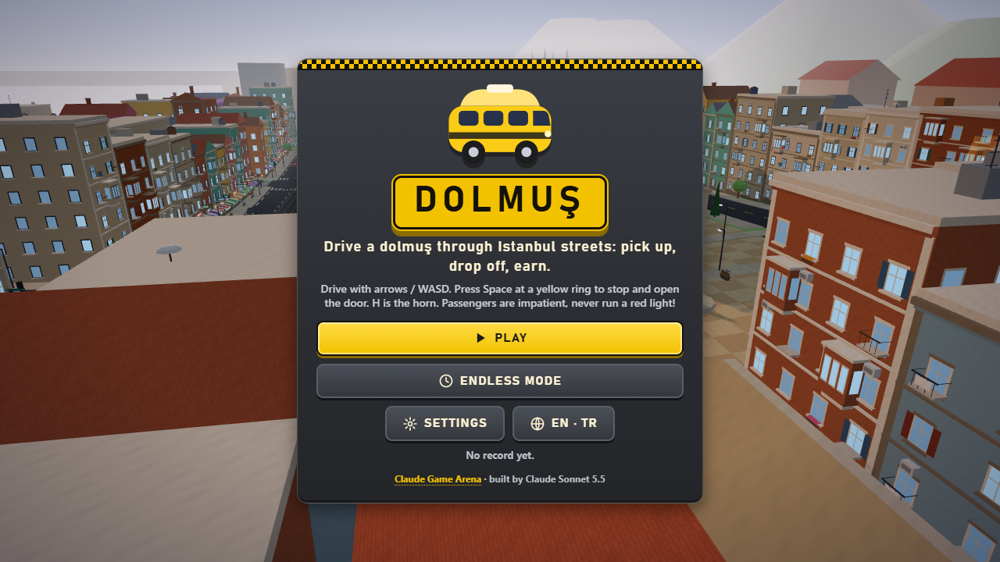<br><sub>Title screen</sub></td>
    <td width="33%">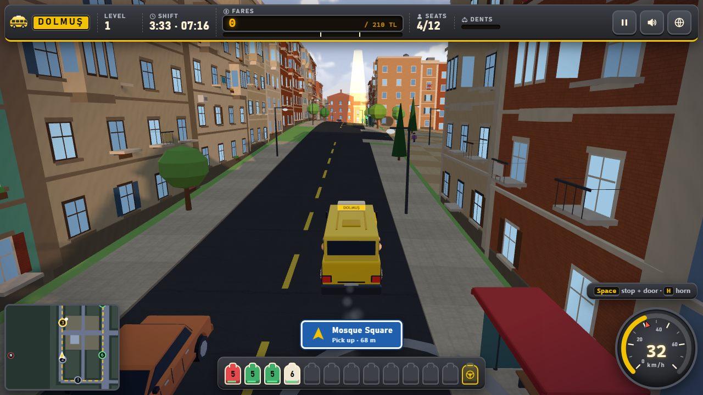<br><sub>Passengers, chat bubbles and tips</sub></td>
    <td width="33%">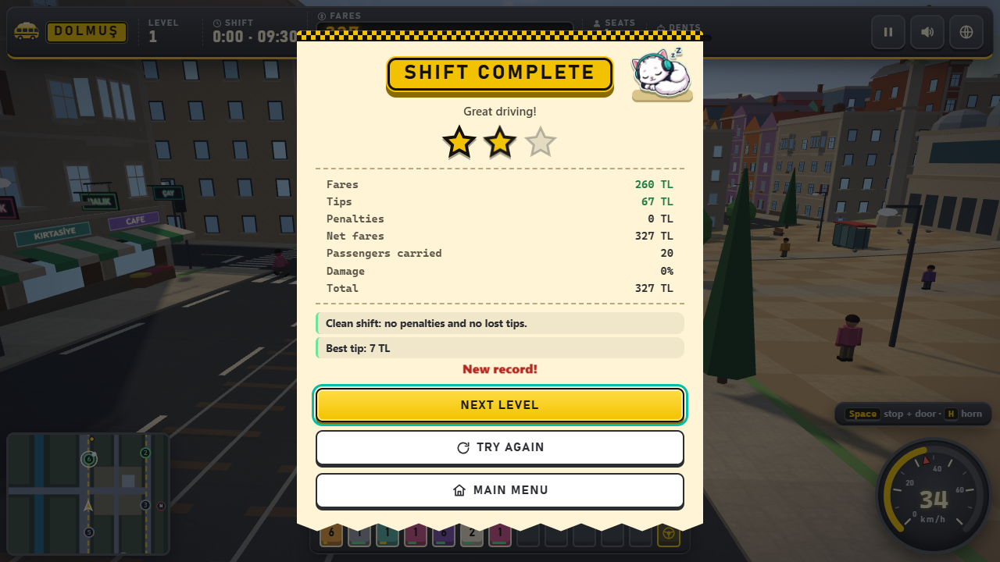<br><sub>Shift summary</sub></td>
  </tr>
  <tr>
    <td>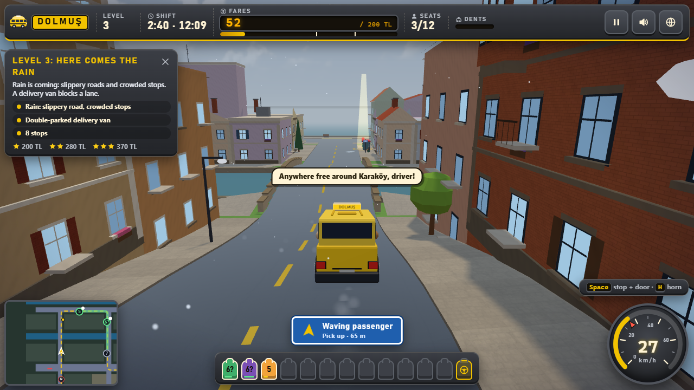<br><sub>Rain and wet roads</sub></td>
    <td>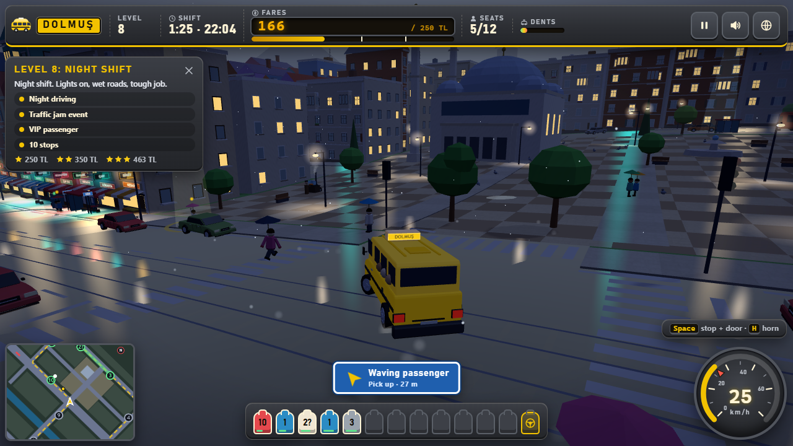<br><sub>Night shift</sub></td>
    <td>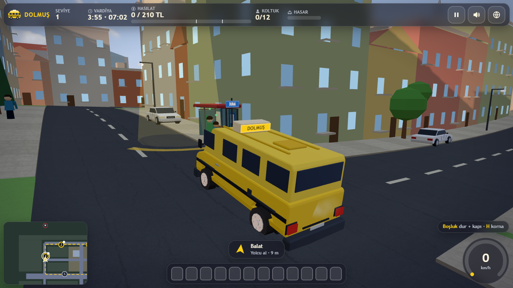<br><sub>At a stop (asset pass)</sub></td>
  </tr>
  <tr>
    <td>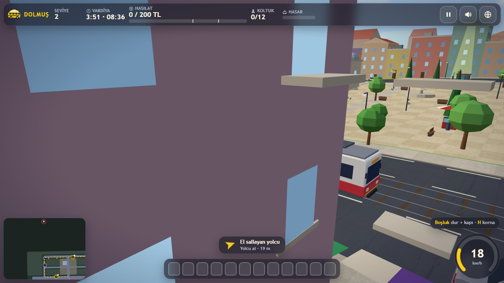<br><sub>The tram</sub></td>
    <td>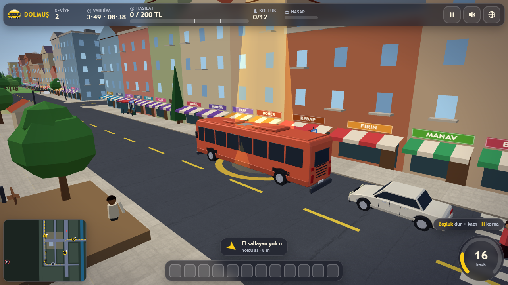<br><sub>A city bus</sub></td>
    <td>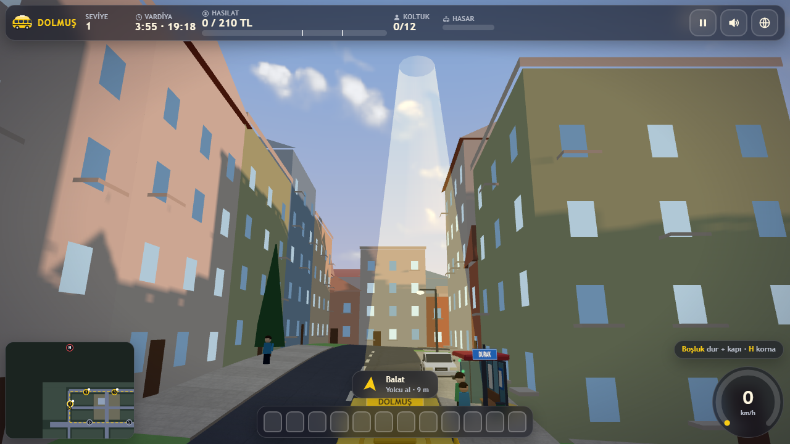<br><sub>Sunset sky</sub></td>
  </tr>
</table>

<details>
<summary><b>Phone layout and the asset pass, before and after</b></summary>

<table>
  <tr>
    <td width="50%">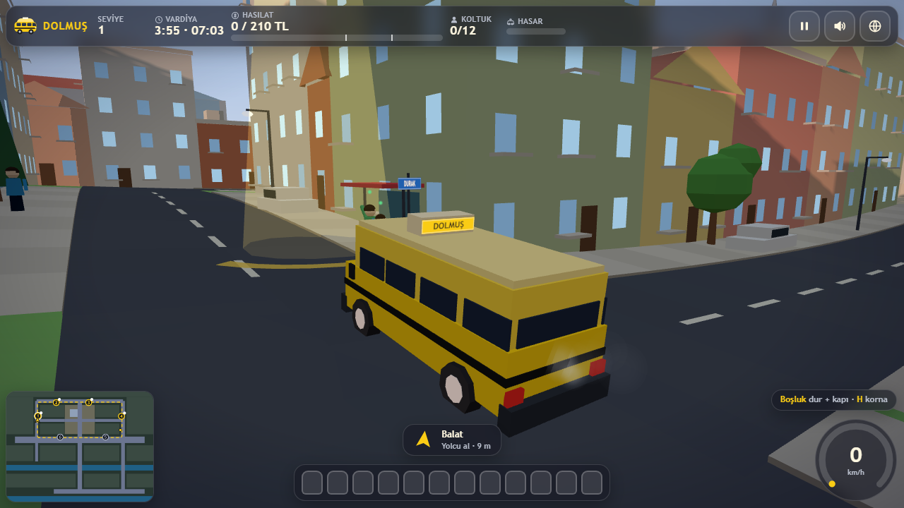<br><sub>Dolmuş, procedural</sub></td>
    <td width="50%"><br><sub>Dolmuş, with the asset pass</sub></td>
  </tr>
  <tr>
    <td>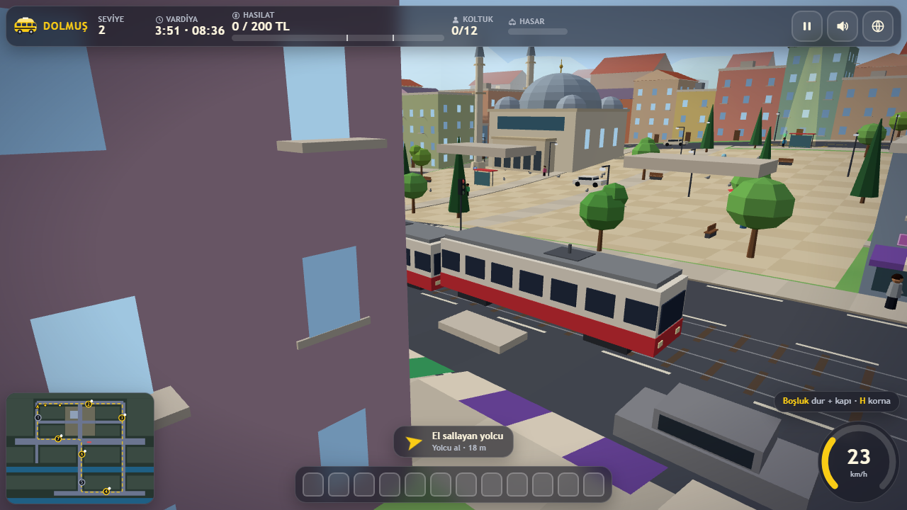<br><sub>Tram, procedural</sub></td>
    <td><br><sub>Tram, with the asset pass</sub></td>
  </tr>
  <tr>
    <td>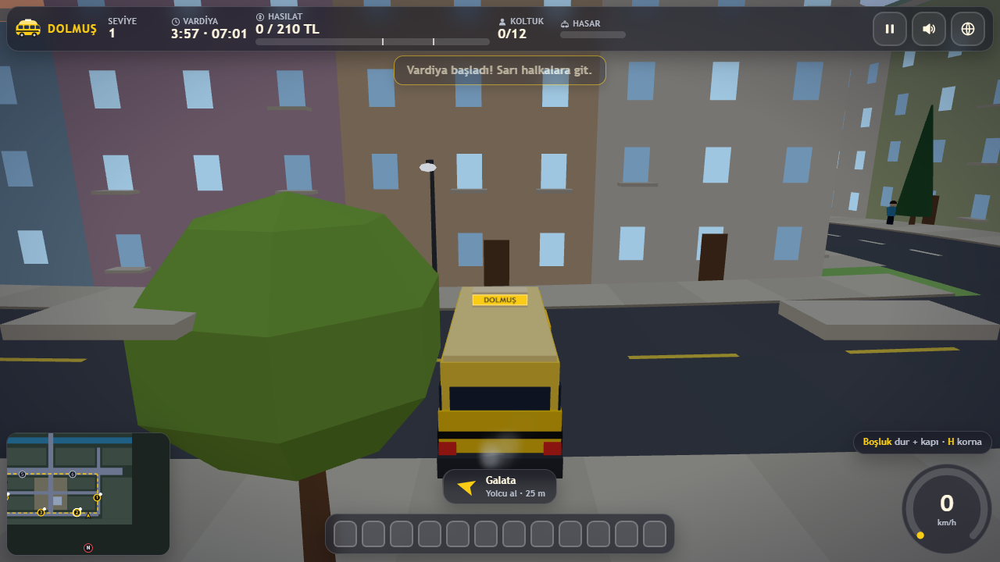<br><sub>Chase camera without the obstacle fix</sub></td>
    <td>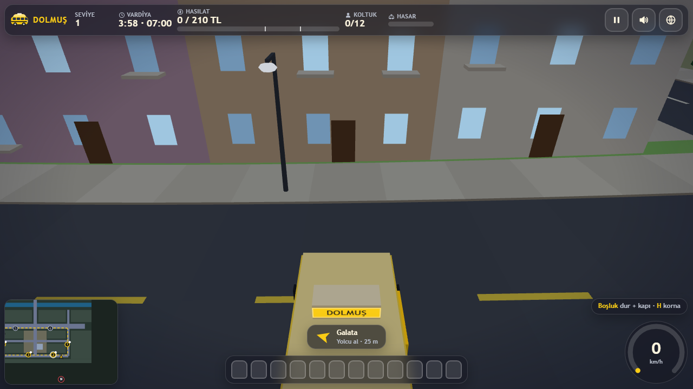<br><sub>Chase camera with the fix</sub></td>
  </tr>
</table>

<p align="center">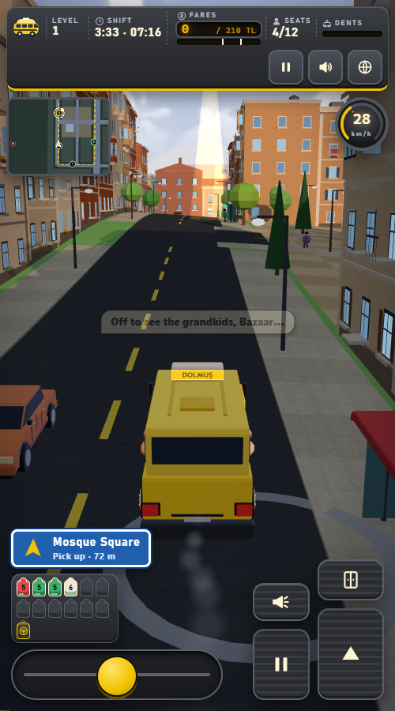<br><sub>On a phone</sub></p>

Promo video: <a href="https://github.com/Furkiozknn/social-videos/releases/download/promo-2026-10/2026-10-28-dolmus-en.mp4">EN</a> &middot; <a href="https://github.com/Furkiozknn/social-videos/releases/download/promo-2026-10/2026-10-28-dolmus-tr.mp4">TR</a>

</details>

## Redesign & Performance

**Art direction:** A taxi-dashboard city. Palette: dolmuş yellow `#F2C200`, asphalt `#2B2D31`, Istanbul brick `#A0522D`, tram red `#C62828` and neon teal `#00BFA6` at night. The UI is an instrument cluster: roof-sign headings, a speedometer dial, an amber LCD fare meter, a blue direction sign and a paper fare receipt as the end screen.

**Visual updates (physics, controls, levels, scoring, saves, flags and the bot are untouched):**
- **Façades:** Every window has a frame, sill, lintel and mullions; shutters, flower boxes, balconies with railings, air conditioners, cumba bay windows, plinths and corner quoins; roofs get chimneys, water tanks, antennas and dishes. Shop fronts feature door surrounds, stall risers, produce crates, café tables and blade signs. On High tier, a world-space masonry texture adds brick courses and stucco mottling. Meshes use one view- and distance-culled draw call per 64 m chunk, leaving city colliders identical.
- **Night and neon:** About 120 neon blade signs (canvas-drawn word atlas) with additive glow halos, subtle flicker, and tinted pavement light pools; warm halos on street lamps; visible stars.
- **Wet roads:** Darkened asphalt mirroring sky gradient at grazing angles, light columns, per-frame mirror streaks of lamps and neon, rain splashes, and persistent puddles.
- **Pedestrians:** Instanced limbs with opposite swing, torso lean, bounce, idle sway, hailing wave, and varied trouser colours.
- **UI:** Dashboard strip with taxi roof-sign brand, amber LCD fare meter with star-threshold rail, dial with pointer, passenger bench chips with headrests, blue direction sign, and cream fare receipt for shift summaries.

**Measured on an Intel UHD 620 (headless Chrome, 1280x720):**

| Scene | Draw calls before → after | Triangles before → after |
|---|---|---|
| Day, chase camera | 41 → 52 | 209k → 278k |
| Rain, chase camera | 49 → 60 | 225k → 293k |
| Night, chase camera | 50 → 62 | 236k → 305k |
| Night, street camera | 50 → 65 | 237k → 323k |

- Page rAF: stayed at the 60 fps vsync cap (60.4 to 60.8 fps; before: 52 to 54 fps day).
- Draw calls: 52 to 65 (well within the 150 budget).
- Verified by bot: `?auto&debug&sim=4000` finished all 8 shifts with 0 JS errors on assets, `?noassets`, and `?low` (stars / net lira: 1: 2/327, 2: 2/356, 3: 2/327, 4: 2/332, 5: 3/312, 6: 2/352, 7: 2/437, 8: 1/265).

<p align="center">
  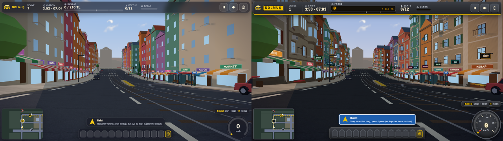<br>
  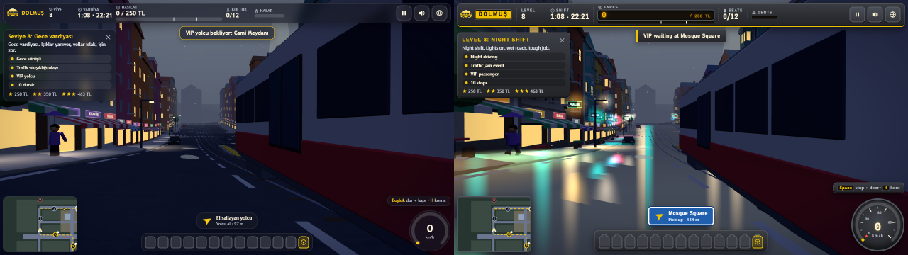<br>
  <sub>Same camera, before (left) and after (right).</sub>
</p>

## Running locally

Serve the folder over HTTP (opening `index.html` directly also works in most browsers, but optional assets load over HTTP):

```bash
python -m http.server 8000
```

Then open <http://localhost:8000/>.

## Made with Claude Code

Built by **Claude Sonnet 5.5** with Claude Code from one prompt: [prompts/dolmus.md](prompts/dolmus.md). The base game is fully procedural: about 300 buildings, roads, trees, the mosque, bridges, and the pier are merged low-poly geometry with vertex colours; cars, buses, the tram, pedestrians, and pigeons are instanced. The engine, horn, rain, tram bell, street ambience, and the arabesk-pop style tune in Hicaz are synthesised with the Web Audio API.

An optional asset pass (about 1.13 MB) adds Blender-built low-poly vehicles and props (the dolmuş with its sliding door, cars, buses, the tram, the van, stop shelters, simit and chestnut carts), Poly Haven detail textures and sky, and Kenney sounds for the door, coins, crashes, and clicks. They load after the first frame on the High tier (sounds on both); procedural versions remain as fallback (`?noassets` skips them). Licences: [CREDITS.md](CREDITS.md); file list and performance details: [docs/assets.md](docs/assets.md). Model scripts: `assets/src/`.

### v2 update

Upgraded by Claude Sonnet 5.5 with Claude Code from [prompts/dolmus-v2.md](prompts/dolmus-v2.md):

- **One click to the road:** Play starts the shift after a 3-2-1 countdown; the first stop is coached with a pulsing ring and an arrow. The language follows the browser.
- **"Müsait bir yerde!" drops:** From level 2, about a third of passengers request to alight at any safe curb within 70 m; crossings, junctions, and signal queues are refused.
- **The fare chain:** Coins hop forward along occupied seats, and the door waits for the last fare before closing.
- **Passenger variety & district flair:** 24 passenger lines per language by passenger type with a no-repeat window (12 boardings in a row are all different). District identity (Balat, Galata / Karaköy, Kadıköy pier), shop awnings, umbrellas and puddles in rain, lit windows and stop-shelter glow at night, and the white Turkish Van kitten on the summary card.

<details>
<summary><b>Technical notes</b></summary>

- **Procedural city geometry:** Merged static meshes with vertex colours keep draw calls low while rendering over 300 buildings, road networks, canal bridges, and the mosque square.
- **Audio synthesis (Web Audio API):** Algorithmic engine rumble, horn, rain, ambient street sounds, and an arabesk-pop modal melody in Hicaz makam without external audio files in base mode.
- **Physics & bot simulation:** Fixed 60 Hz simulation loop decoupling physics and AI from frame rate, allowing headless fast-forward testing (`?auto&sim=N`) of complete 8-shift campaigns in seconds.
- **Dual-tier rendering:** High tier with dynamic shadows, world-space textures, wet-road reflections, and optional low-poly GLTF assets; `?low` tier disabling shadows and extra passes for smooth 60 fps on mobile GPUs.

</details>

### Claude Game Arena

Dolmuş is part of the **Claude Game Arena** series, where each game is built by a Claude model from one prompt.

[Hisar](https://furkiozknn.github.io/kale-savunmasi/) · [Çay Ocağı](https://furkiozknn.github.io/cay-ocagi/) · [Çini Ustası](https://furkiozknn.github.io/cini-ustasi/) · [Martı](https://furkiozknn.github.io/marti/) · [Kervan](https://furkiozknn.github.io/kervan/) · [Peri Golf](https://furkiozknn.github.io/peri-golf/) · [Mehter](https://furkiozknn.github.io/mehter/) · [Boğaz Vapuru](https://furkiozknn.github.io/bogaz-vapuru/) · [Simit Fırını](https://furkiozknn.github.io/simit-firini/) · [Karagöz](https://furkiozknn.github.io/karagoz/) · [Lale Bahçesi](https://furkiozknn.github.io/lale-bahcesi/)

**Round 5:** [Kapadokya Balonu](https://furkiozknn.github.io/kapadokya-balonu/) · [Ebru](https://furkiozknn.github.io/ebru/) · [Kırkpınar](https://furkiozknn.github.io/kirkpinar/) · [Çarşı Kaçışı](https://furkiozknn.github.io/carsi-kacisi/)

**Round 6:** [Topkapı Gecesi](https://furkiozknn.github.io/topkapi-gecesi/) · [Hamsi](https://furkiozknn.github.io/hamsi/) · [Pamukkale](https://furkiozknn.github.io/pamukkale/) · [Mimar Sinan](https://furkiozknn.github.io/mimar-sinan/)

## License

MIT, see [LICENSE](LICENSE). Third-party assets are CC0, see [CREDITS.md](CREDITS.md).

Like the game? You can support new rounds on [Buy Me a Coffee](https://buymeacoffee.com/furkiozkann). The game stays free.
